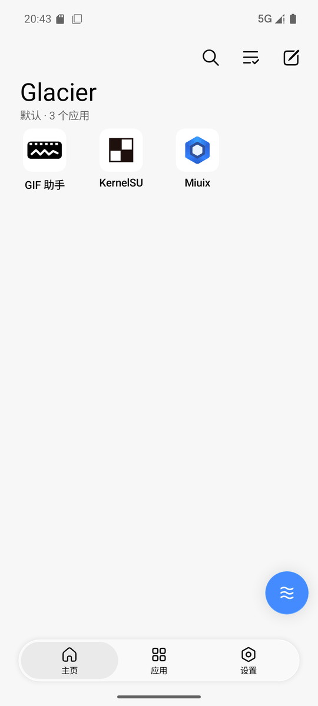
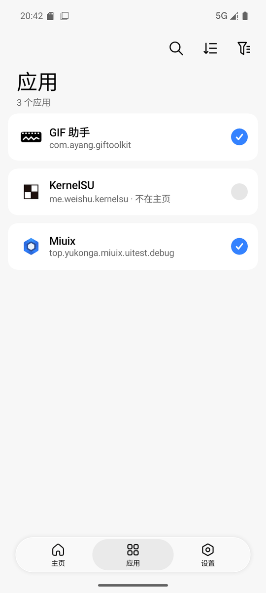
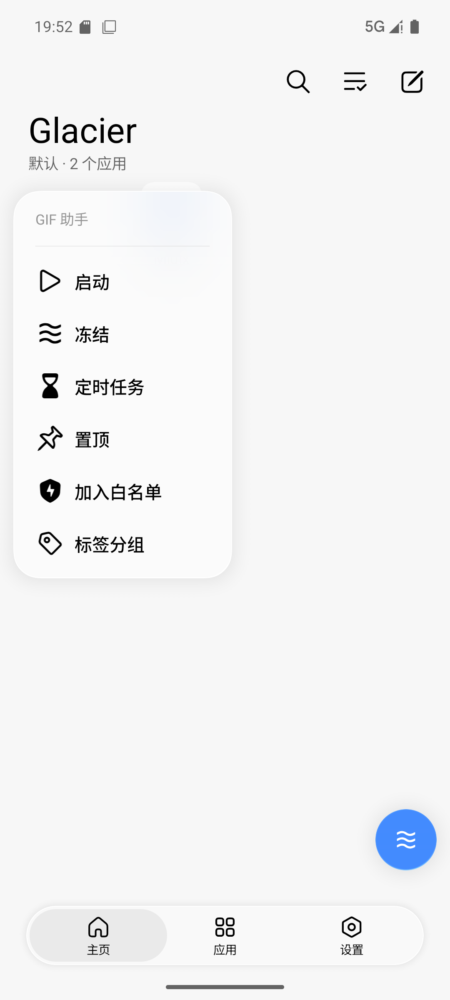
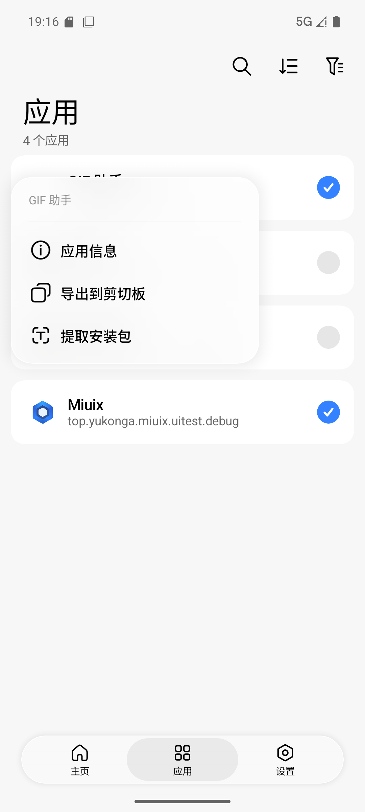
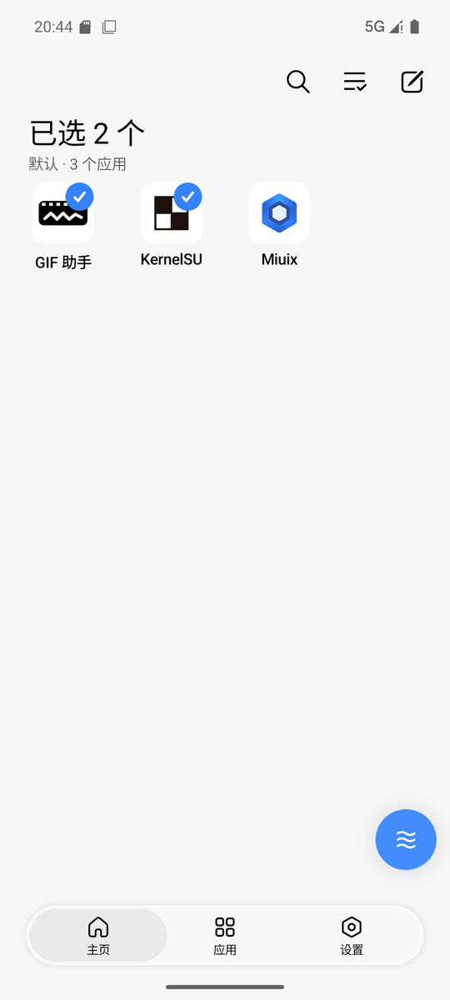
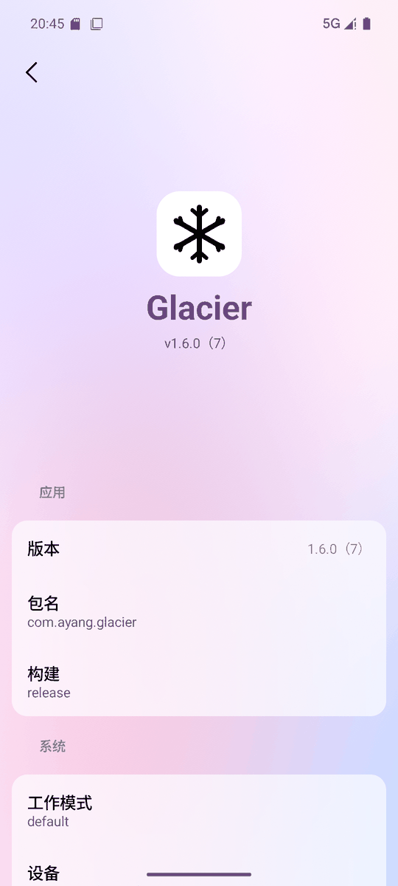

# Glacier

把不常用的应用冻起来，别让它们在后台跑。

界面照着 MIUIX OS4 和 MIUIX OS4 Glass 搭的，没有引入 Material3。

包名 `com.ayang.glacier`，最低 Android 13（API 33）。

| 主页 | 应用页 |
| --- | --- |
|  |  |

## 下载

到 [Releases](https://github.com/Ayang233/Glacier/releases) 拿 `Glacier-release.apk`，
`adb install` 或者直接在设备上点开。包名和签名一直没变，可以覆盖装。

## 装完先做这一步

Glacier 自己不申请系统权限，真正执行冻结的是设备侧的能力。刚装好是 `default` 模式，
这个模式只记状态，不会真的冻任何应用。去「设置 → 通用 → 工作模式」挑一个本机支持的方式并授权：

- Shizuku：强停 / 禁用 / 隐藏 / 挂起
- Root：同上
- Dhizuku 或设备所有者
- Island：冻结 / 挂起
- 特权应用

想让自动冻结跳过正在通知或者正待在前台的应用，还要给通知使用权和使用情况访问权。

## 怎么用

主页放你挑出来的应用，应用页放全部应用。两边的长按菜单不一样。

**主页**

- 点图标启动。
- 长按出这台应用的菜单：启动、冻结或解冻、定时任务、置顶、加入白名单、标签分组、添加到主屏幕、
  导出到剪切板、从主页移除。应用已经冻结时，最后会多一行「解冻并从主页移除」。
- 右下角 FAB 把主页里还没冻的一次冻掉。
- 顶栏「多选」进多选，标题变成「已选 N 个」，点图标勾选。这时 FAB 只处理选中的那几个，
  一个都没选就还是整页。再点一次「多选」或者按返回就退出。

**应用页**

- 点一行把它移进或移出主页，行尾那个勾表示在不在主页。这一页没有多选，也没有计数。
- 长按是管理菜单：应用信息、导出到剪切板、提取安装包。
- 冻结不在这一页做。

二级页（关于、开源许可证）没有底栏，跟着一级页一起转场。

## 更多截图

| 主页长按菜单 | 应用页长按菜单 |
| --- | --- |
|  |  |
| 多选 | 关于 |
|  |  |

## 构建

需要 JDK 21 和 Android SDK（compileSdk 37.2 / build-tools 37.0.0）。

```bash
export JAVA_HOME=/path/to/jdk-21
./gradlew :app:assembleDebug
./gradlew :app:assembleRelease
./gradlew :app:testDebugUnitTest      # 纯 JVM 单测：搜索键、匹配、菜单结构
```

minSdk 33（`miuix-blur` 的 RuntimeShader 门槛），targetSdk 36。产物：

```
app/build/outputs/apk/debug/Glacier-debug.apk
app/build/outputs/apk/release/Glacier-release.apk
```

MIUIX 走 composite build 引入，默认找 `../miuix`，可以用 `MIUIX_DIR` 指到别处。
第一次构建前先把 MIUIX 切到基线提交并打上本地补丁：

```bash
tools/miuix-baseline.sh pin 44f1d31580bd127360d79bdb0bb869bd6c5af025
tools/miuix-baseline.sh verify
tools/miuix-baseline.sh status
```

细节和升级流程写在 [MIUIX_BASELINE.md](MIUIX_BASELINE.md)。

## 代码结构

```
app/src/main/kotlin/com/ayang/glacier/
├── GlacierApplication.kt     进程入口：装配数据层和系统层，恢复主题与自动冻结
├── app/                      对外 API 契约（Action / Scheme）
├── domain/                   纯模型：ManagedApp、Tag、WorkingMode、AppEntry
├── data/                     偏好、JSON 存储、搜索索引、Repository
├── platform/                 Android 能力封装：包状态、图标、通知、调度、快捷方式
├── system/                   冻结后端：Shizuku / Root / Dhizuku / DeviceOwner / Island / 特权
├── feature/                  home / apps / settings / about / api
└── ui/                       主题、Glass 环境、Shell、通用组件
```

页面不直接碰系统服务，链路是：页面 → `GlacierRepository` → `FreezeController` → 具体后端。

## 玻璃结构

```
Scaffold(Transparent, insets = 0)                 ← 弹层宿主，最外层
└ Box(fillMaxSize)
   ├ Box(fillMaxSize).layerBackdrop(root)         ★录制层 R（满屏）
   │  └ NavDisplay
   │     ├ 一级页 Box: 页内录制层 → HorizontalPager，外加 GlassNavigationBar
   │     └ 二级页 About / Licenses（没有底栏）
   └ GlassNavigationRail(backdrop = root)         宽屏覆盖式侧栏，与 R 同级
```

底栏是一级目的地自己 Scaffold 的东西，和 MIUIX 官方示例一样装在一级页里，
所以进二级页时它跟着页面一起走，不用藏也不用缩。它采样的是页内那层录制（`pageBackdrop`）。

页面内部（`PageFrame`，对着官方 `GlassPage` 写的）：

```
Box
├ Scaffold(containerColor = surface, insets = 0)
│  ├ topBar    = GlassTopAppBar(pageBackdrop)
│  ├ bottomBar = Spacer(LocalShellBottomBarHeight)   透明占位，正文和 FAB 按真实高度让位
│  └ body      = Box(fillMaxSize).layerBackdrop(pageBackdrop)
│                 └ 列表 / 网格
└ overlay()                                          搜索和弹层，画在 Scaffold 之上
```

玻璃有三条不能破的规矩：采样方不能是录制层的后代；采样源在采样方整个绘制区域都得有像素；
尺寸和坐标只在量测、布局、绘制阶段读。展开写在 `docs/architecture/glass-contract.md`。

## 和 MIUIX 对齐的部分

底栏 24dp 横向内边距、页面 12dp 留白、官方脚手架与滚动/弹层动画、关于页结构与尺寸、
squircle 图标轮廓，都是照着 MIUIX 源码和 `example/shared` 一项项对过的。
页面让位走官方 `AppPageInsets` 契约（`ui/PageInsets.kt`，从官方 `utils/PageUtils.kt` 搬来的），
`NavDisplay` 始终满宽，侧栏宽度和系统安全区只作用在内容上，背景和顶栏的模糊带不会被切断。

宽屏断点读窗口尺寸（官方 `AdaptiveUtils` 用的 `LocalWindowInfo.containerSize`），
不是屏幕尺寸，分屏和自由窗口下不会误判成宽屏。

多选的勾选、顶栏标题切换、弹层进出，用的都是库里的组件和曲线（`Checkbox`、
`AnimatedContent` 加 `GlassMotion`），没有自己画的图标描边或高亮层。

审计与验收记录：

- [基线、升级流程与组件对照](MIUIX_BASELINE.md)（当前 MIUIX `44f1d315`）
- [R10 两页菜单分工](docs/audit/miuix-os4-r10-audit.md) · [R9 按压反馈与选中态](docs/audit/miuix-os4-r9-audit.md)
- [R8 宽屏间距与自定值清单](docs/audit/miuix-os4-r8-audit.md) · [R7 交互整改](docs/audit/miuix-os4-r7-audit.md)
- [R6 自造轮子清查](docs/audit/miuix-os4-r6-audit.md) · [MIUIX 官方契约摘录](docs/reference/miuix-os4-contract.md)

## 许可证

Glacier 以 GPL-3.0-or-later 发布，含源自 [Hail](https://github.com/aistra0528/Hail)
（作者 aistra0528，同为 GPL-3.0-or-later）的衍生代码。完整许可证见 `LICENSE`，
第三方组件和来源见 `NOTICE.md`，应用里也有「开源许可证」页。

## 发布

- 仓库：https://github.com/Ayang233/Glacier
- Release：https://github.com/Ayang233/Glacier/releases

Release APK 用独立密钥签名，`keystore/` 和 `signing.properties` 不入库。
这两个文件不在的机器上 `assembleRelease` 会退回 debug 签名，只能本机跑，别拿去发。
